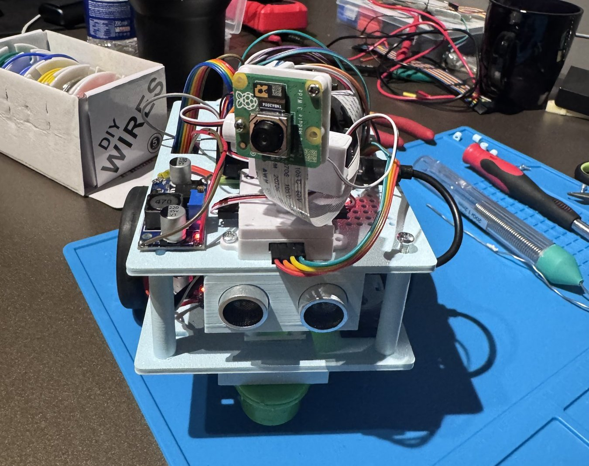
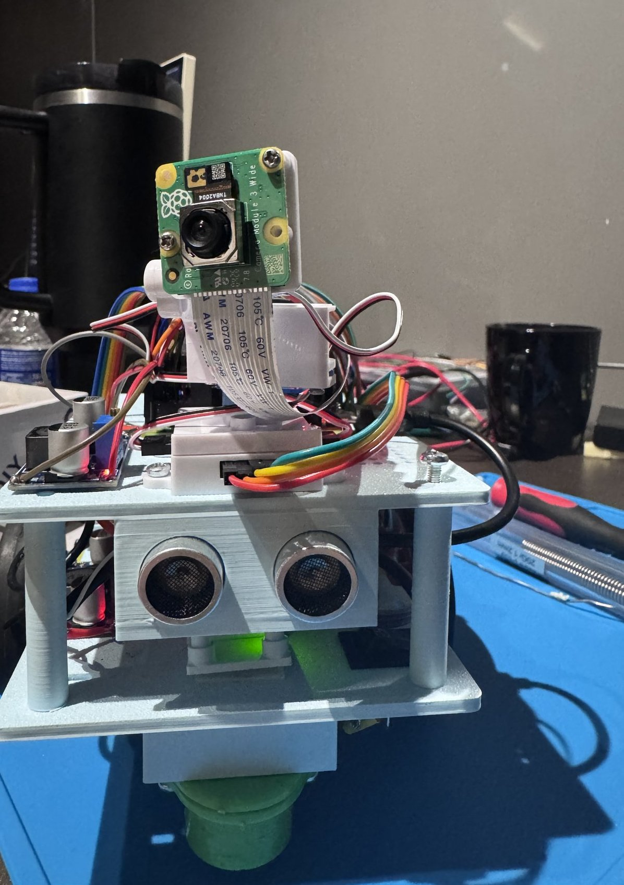
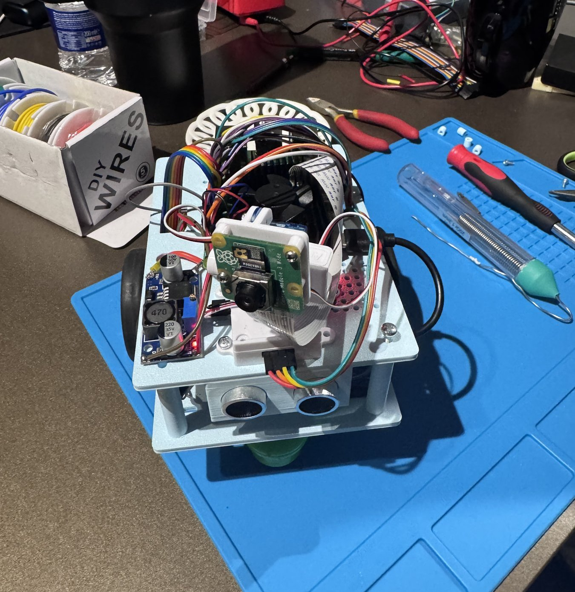
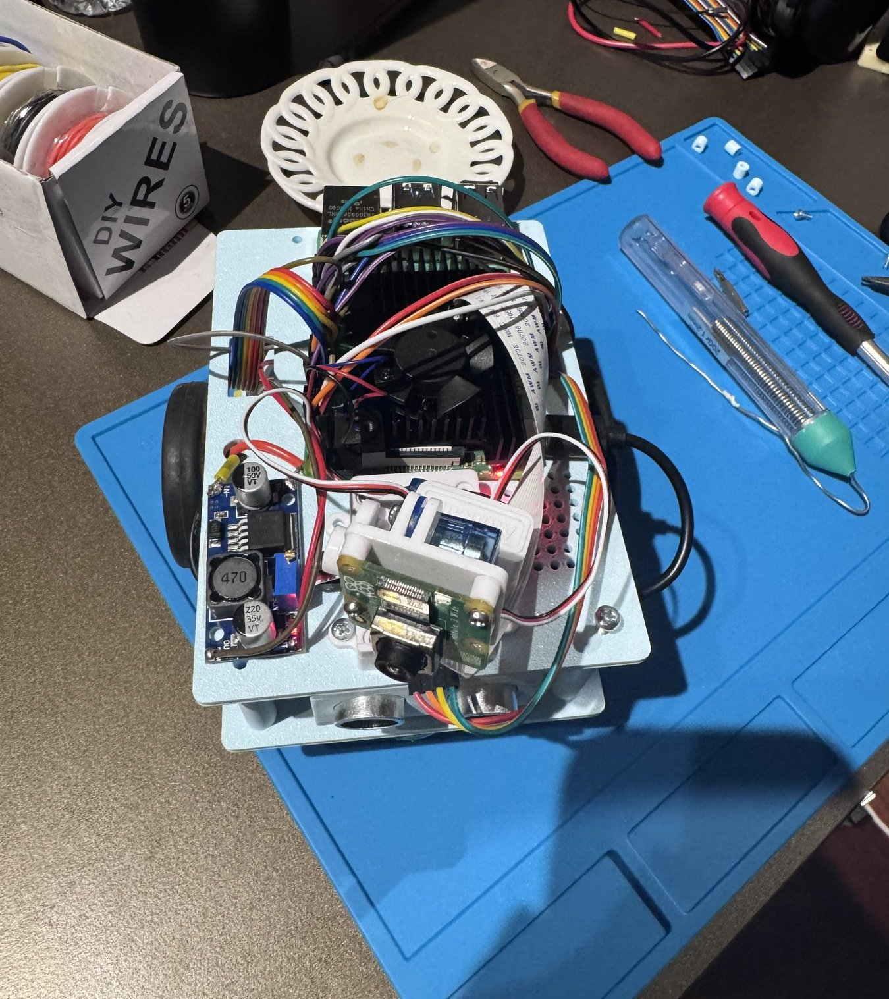
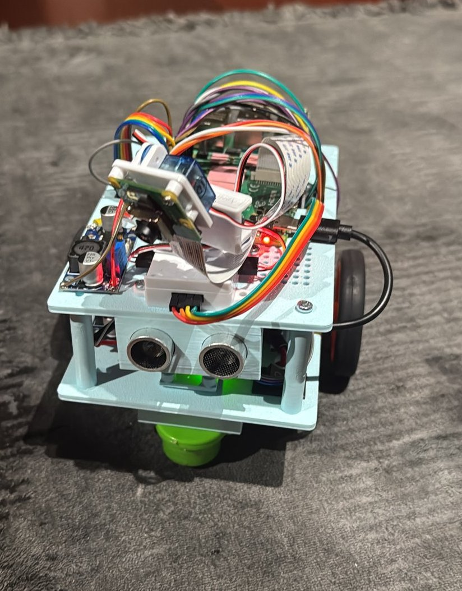
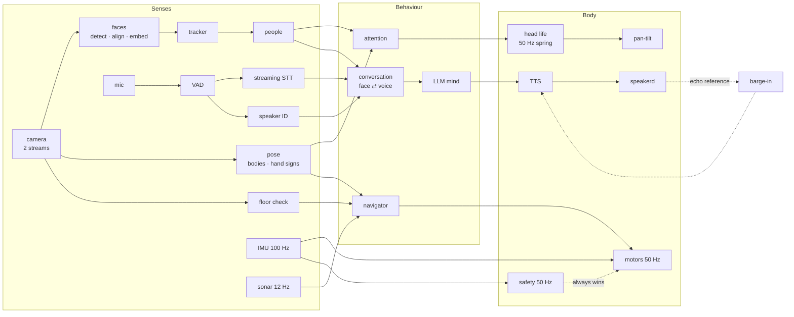
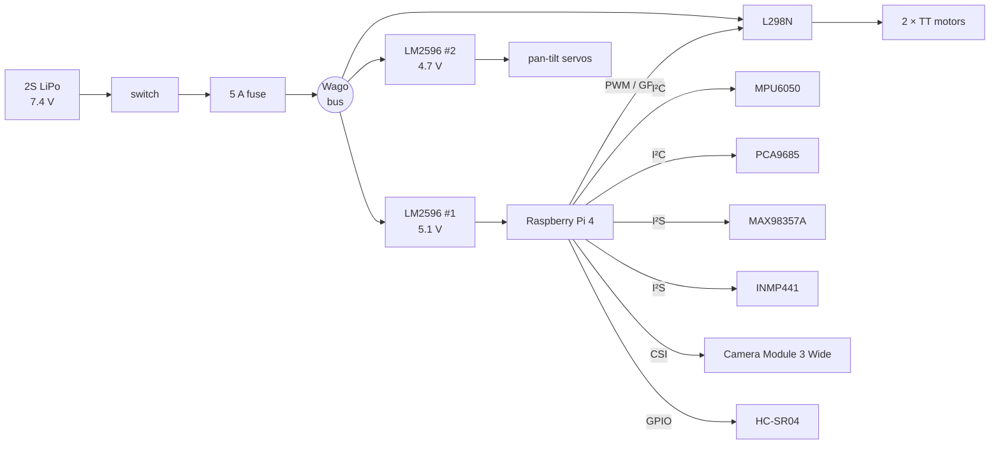

<div align="center">

# Arcby

**A home robot I designed, 3D-printed, wired and programmed from scratch. It recognises the people it lives with,
notices when someone looks at it, holds a spoken conversation in Turkish, and drives around on its own without
hitting anything.**




**[What it does](#what-it-does) · [How it works](#how-it-works) · [Hardware](#hardware) ·
[Engineering](#engineering-practice) · [Lessons](#lessons-from-the-build) · [Run it](#running-it)**

</div>

| | |
|---|---|
| **Compute** | Raspberry Pi 4 (4 cores, 4 GB): six neural networks on the CPU at the same time, no GPU or accelerator |
| **Vision** | 12–15 fps face detection + recognition, pose estimation for people whose face is hidden |
| **Conversation** | local voice activity detection + speaker ID, streaming STT, an LLM reply streamed sentence by sentence into TTS; a filler ~2.5–3 s and the answer ~4.5–6 s after you stop talking (sum of the measured stages) |
| **Driving** | gyro-closed-loop turns within 2.4°; 0 collisions in 36 simulated rooms and in the first real runs |
| **Code** | ~26k lines of Python (51 modules in one package), ~13k lines of tests (1044 tests with fake hardware, ~100 s on a laptop) |
| **Mechanics** | one parametric Fusion 360 model, every part printed in PLA, all print files included |

## What it does

- **Knows its people.** On-device face recognition tells household members apart and learns new people by asking
  their name. It ignores "faces" that never move, such as a framed photo on the wall.
- **Feels alive.** The camera head moves like a creature, not a CCTV camera. It glances at newcomers, gets bored,
  breaks eye contact, nods while you speak, turns towards voices and moves less at night.
- **Talks.** Look at it and speak. It checks that the face and the voice belong to the same person, answers through
  an LLM in natural spoken Turkish, and stops at once when you talk over it.
- **Drives.** It explores a room, follows someone who beckons ("gel gel"), stops for a raised hand or "dur", and
  wanders by itself when bored. A 50 Hz safety layer underneath can always stop the motors.
- **Improves itself.** When it is plugged into the wall (no battery = it can't move), it re-tunes its own face
  threshold from its own recordings ("learning mode").

<!-- Demo video: drag an .mp4 into a GitHub issue comment, copy the link and paste it on its own line here. -->

## Gallery

| | |
|:---:|:---:|
|  |  |
| Pan-tilt camera head (Camera Module 3 Wide) above the ultrasonic sensor | Two decks on four pillars; buck converter, wiring, ball caster |
|  |  |
| Upper deck: Raspberry Pi 4, pan-tilt, I²S speaker and mic, breadboard bus | At home on the rug it learnt to cross |

## System overview



It all runs as **one Python process** with one thread per sensor or actuator. Each module owns its hardware and
writes only its own fields into a shared, timestamped state. This is the ROS node/topic pattern without the overhead
of ROS, so modules can become ROS 2 nodes later. Data older than its timeout counts as missing, and missing data
stops the motors. → [`docs/architecture.md`](docs/architecture.md)

## How it works

### Seeing people → [`docs/vision.md`](docs/vision.md)

| Stage | Model | Idea |
|---|---|---|
| Detect | YuNet | fast face boxes + 5 landmarks on a small 576×324 stream |
| Quality, landmarks | SCRFD-500M | re-run on a crop of the **2304×1296** stream: 4× the pixels for faces 3 m away; its score rejects lamps and hands |
| Align | similarity transform | warps the 5 landmarks onto the ArcFace 112×112 template, so the embedder always sees a face in the same pose |
| Embed | ArcFace R50, **int8** | each face → a 512-d unit vector; same person = small angle (cosine similarity) |
| Match | nearest neighbour | best cosine over each person's stored vectors vs one threshold |

- **Thresholds come from error rates, not guesses.** The match threshold is the cosine at which a chosen share of
  strangers would be accepted (the false-accept rate). It was set first on LFW, then on the robot's own recordings,
  where same-person faces score a median of 0.60 and the two brothers (the most alike pair) 0.29.
- **Quantisation.** I quantised ArcFace R50 to int8 myself, with calibration images from LFW. That doubled its speed
  (802 → 410 ms per face) with no measured loss, and beat MobileFaceNet on photos the robot took at 3 m (100 % vs 98 %).
- **Tracking in head angles, not pixels.** Detections are tracked in pan/tilt angles, so a track survives the head
  moving. A track's identity is the majority vote of its last 3 looks.
- **Telling a photo from a person.** The camera's real pose is measured from the picture itself (phase correlation
  against reference frames), and face positions are kept relative to the background. Servo jitter cancels out: a
  framed photo spreads 0.01°, a person sitting still 0.77°.
- **Gaze** comes from the 5 landmarks of the high-resolution crop (head yaw/pitch), smoothed with hysteresis. It
  separates "looking at me" from "looking at the phone" perfectly (AUC 1.00) at 1–2 m. Dedicated gaze CNNs scored
  0.58–0.97, so they were not used.
- **Bodies**: YOLO26n-pose (exported to ONNX, my own NumPy NMS) finds people whose face is hidden and estimates
  where their face must be. A wave is 2–3 Hz, too fast for a 3 Hz pose model (it would alias), so while a forearm is
  up, a patch around the wrist is frame-differenced at the full camera rate instead.
- **Hand signs** are read from the forearm in the person's own shoulder widths: "gel gel" = come, a raised still
  hand = stop. A false "come" starts a drive nobody asked for, so that detector is strict; a false "stop" costs
  nothing, so that one is lenient.

No OpenCV and no TensorFlow: everything is `onnxruntime` + NumPy + Pillow.

### Hearing and talking → [`docs/ears.md`](docs/ears.md)

```
mic 48 kHz → 100 Hz high-pass → AGC (learns from speech only) → 16 kHz (63-tap FIR) → Silero VAD
   → utterance (0.3 s pre-roll, ends after 0.45 s of silence)
   ├─ streams over a WebSocket to live STT while it is being said (only if someone looked at the robot)
   └─ CAM++ speaker embedding → whose voice? ─┐
                                              ├→ conversation → LLM (streamed) → TTS per sentence → speakerd
   face tracks + gaze → who is looking? ──────┘
```

- **Listening rule.** It only listens when someone *faces* it as a sentence starts, or a conversation is already
  open. Side talk in the room is never sent anywhere.
- **Who is speaking.** A local speaker-verification model maps each utterance (80 log-mel filterbanks,
  mean-normalised) to a 192-d voice print, matched with k-nearest-neighbours plus a margin over the next person.
  Prints are learnt only from sentences whose speaker the robot *saw*, so face and voice teach each other. If
  brother A is looking but the voice is brother B's, the robot answers B.
- **Low latency through pipelining.** STT runs while you talk (words arrive ~0.4 s after you stop), the LLM reply is
  streamed, and each sentence goes to TTS as soon as it is complete. Sentence 2 is synthesised while sentence 1
  plays. A cached filler ("Hmm.") covers the gap. End of speech to the answer went from 10–25 s to ~4.5–6 s.
- **Barge-in.** The robot's own voice reaches its mic as loud as a person 1–2 m away, and a waveform echo canceller
  removed only 6–8 dB through the distorting little speaker. So it predicts the echo's **power in 9 frequency bands**
  from what it is playing (a learnt coupling per band, plus the room's decay and lag), and calls it a person when
  3+ bands are well above the prediction. A false alarm raises the bands that fired, so the detector tunes itself.
- **No pops.** Opening or closing the audio card switches the amplifier, which pops. So the card lives in its own
  process (`speakerd`) that streams silence forever; speech is mixed into that stream.

Faces, voice prints and recordings never leave the robot. Only the sentence being transcribed and the reply text go
to cloud APIs, each with a daily budget.

### Moving and staying safe → [`docs/architecture.md`](docs/architecture.md)

- **Differential drive.** Forward speed is the mean of the two wheels, turn rate their difference. Velocity mode takes
  `(speed, turn °/s)`: a **feed-forward** term (400 °/s per unit of PWM difference, measured on carpet) plus a
  **PI loop** on the gyro's yaw rate, and heading hold when driving straight. There are no wheel encoders: distance =
  calibrated speed × time, and the gyro makes the angles exact.
- **Tilt estimation.** A complementary filter: an "up" vector rotated by the gyro (fast, but drifts) is pulled
  slowly towards the accelerometer's gravity (slow, but no drift). The pull is skipped while |a| is far from 1 g, so
  spins on a tilted floor stay correct.
- **Friction is all-or-nothing.** Below ~250 °/s on carpet, both-wheel spins stall. Slow turns therefore pivot on
  one wheel, alternating forward and backward pivots so the robot does not walk away. The stop lead (when to cut the
  motors before the target angle) is learnt per turn size.
- **Safety has the last word.** A 50 Hz loop latches a stop on tip-over, a bump, a stale IMU or low battery. A jolt
  only counts as a bump if the nose was calm just before: at take-off the nose lifts ~15° and lands with a thump that
  looks like a hit. A 0.3 s motor watchdog, motor pins pulled low at boot, and a 3 s black-box CSV on every stop.

### Navigation → [`docs/navigation.md`](docs/navigation.md)

```
   lens 14 cm up, tilted 28° down
     \   each pixel row is a ray; where it meets the floor plane = its distance
      \
  =====*========================== floor
```

- **The camera as a range sensor.** From the lens height and the head's pan/tilt, every pixel maps to a point on the
  floor (inverse perspective). The patch just in front, when the sonar says it is free, is learnt as "floor": r-g
  chromaticity + brightness histograms, so shading doesn't change the colour. 36 rays go up the image, and the first
  non-floor cell on each is an obstacle's foot at a known distance. ~5 ms per frame.
- **Sensor fusion by blind spots.** The sonar misses cables and slanted walls; the camera misses overhangs and glass.
  Each sensor clears only its own points in a short-lived local map (30 s / 2 m, because dead reckoning drifts), and
  the robot drives only through ground it *saw* free in the last second.
- **Rug edges.** A straight line where most rays stop is a floor edge, not a wall, but only if the sonar hears
  nothing there. Then it crawls over and learns the new floor.
- **Brain.** A state machine (scan → choose → turn → drive → re-scan, HELP when boxed in) that is pure logic: a
  percept goes in, a command comes out. The same code runs on the robot and in a simulator of random living rooms
  with noisy sensors and wrong speed estimates. Results: 0 contacts in 36 simulated rooms, and 0 in the first real
  runs on a rug.

### Claude as the robot's body
[`code/body_mcp.py`](code/body_mcp.py) is a dependency-free **MCP server**: a Claude session gets the tools `status`,
`move`, `turn`, `look`, `see`, `stop` and `reset`, all behind the same safety layer. On the first floor run it drove
20 cm (19 measured) and turned +90° (+89.7° measured).

## Hardware

<table>
<tr><td valign="top" width="50%">

**Mechanics**: [`cad/`](cad/)
- Every part printed in PLA on a Bambu Lab A1, from **one parametric Fusion 360 model** that is kept identical to the
  real robot
- 2 decks on 4 pillars: power and drive below, brain, head and audio above
- The battery slides into rails under the base plate
- A small test coupon printed before every big part

</td><td valign="top">

**Electronics**: [`docs/wiring.md`](docs/wiring.md)
- Raspberry Pi 4B, Camera Module 3 Wide on an Arducam pan-tilt (PCA9685, I²C)
- MPU6050 IMU, HC-SR04 sonar (run on 3.3 V, so no level shifter)
- L298N H-bridge, 2 × TT gear motors
- MAX98357A I²S amp + speaker, INMP441 I²S MEMS mic
- 2S LiPo → 5 A fuse → two LM2596 bucks (5.1 V Pi, 4.7 V servos)

</td></tr>
</table>



Design details that matter: a common ground everywhere; the motor pins sit on GPIO 9+ (GPIO 0–8 boot HIGH and would
twitch a wheel) and are pulled low in `config.txt`; the servos get 4.7 V because they are rated for 4.8 V max.
→ [BOM](docs/hardware.md) · [wiring](docs/wiring.md) · [pinout](docs/pinout.md) · [printing](docs/printing.md)

## Engineering practice

- **Tests without hardware.** 1044 unit tests use fakes: a register-level MPU6050, a PCA9685, a camera, a
  closed-loop robot model for the motor controller. `python3 -m unittest discover -s code/tests -t code`
- **Conversation simulator.** A scripted room (who looks, who talks, what is heard) replays whole conversations
  against the real conversation logic. Known gaps are recorded as expected failures. → [`code/sim/`](code/sim/)
- **Measure first.** One interactive test script per hardware unit, and bake-offs on the robot's own data before
  picking any model. → [`code/hwtest/`](code/hwtest/)
- **Everything recorded.** Every sensor stream goes into a local dataset (capped, always 2 GB of disk kept free) for
  tuning from real data. A power breadcrumb (one fsynced line a second) explains sudden power cuts.
- **Hard limits on anything that can break hardware**: servo ranges, a speaker level cap (a speaker died after hours
  at 100 %), refusing to drive without the battery.
- **Privacy by design.** Real names live only in a git-ignored file, and the tests use example names. A pre-commit
  hook refuses data files, secrets (patterns + gitleaks) and real names. Photos are stripped of EXIF/GPS by
  [`tools/clean_photos.py`](tools/clean_photos.py).

## Lessons from the build

- **`-0.0` spun the robot the wrong way.** The direction was taken from the sign of a zero.
- **The "noisy room" was my own code.** A per-chunk mean subtraction made a 31 Hz click train louder than quiet
  speech. Removing it took quiet speech recognition from 15/28 to 28/28 clips.
- **The VAD went deaf after a minute.** Its recurrent state drifted under loud noise, so it is now reset after
  silence.
- **An "unknown person" was a framed graduation photo.** This led to stillness measured against the background.
- **A pop at the end of every phrase** was a WAV header and a C2PA metadata block played as audio.
- **Desk calibration was off by 23–26°.** Camera angles are calibrated on the floor against a target ≥ 1 m away.
- **The first rug runs never left the rug.** It took the rug's edge for a fence; edges are now tested only in the
  robot's path, with the sonar as referee.

## Repository layout

| Path | Contents |
|---|---|
| [`code/`](code/) | the programs: `alive.py` (the robot), `nav.py`, `drive_web.py`, `body_mcp.py`, tools |
| [`code/robot/`](code/robot/) | the robot package: hardware, vision, hearing, voice, behaviour, navigation, safety |
| [`code/tests/`](code/tests/), [`code/sim/`](code/sim/) | unit tests with fake hardware; conversation and room simulators |
| [`code/hwtest/`](code/hwtest/) | interactive hardware tests, calibrations and model bake-offs |
| [`pi/dashboard/`](pi/dashboard/) | stdlib-only web dashboard: health, live state, people, learning |
| [`cad/`](cad/) | Fusion 360 archive, STEP, every print file |
| [`docs/`](docs/) | hardware, wiring, architecture, vision, hearing, navigation |
| [`tools/`](tools/) | Fusion export helper, photo cleaner, leak-guard hook |

## Running it

No robot needed for the tests and the simulators:

```bash
pip install -r code/requirements.txt
python3 -m unittest discover -s code/tests -t code    # 1044 tests, ~100 s
python3 code/sim/run.py                               # 22 conversation scenarios, ~5 s
python3 code/nav.py --sim                             # a random living room, live on a web page
```

On the robot (Raspberry Pi OS 64-bit; `sudo apt install python3-picamera2 python3-gpiozero`):

```bash
python3 code/get_models.py        # download + verify the ONNX models (sha256)
python3 code/hwtest/bringup.py    # check every module after power-on
python3 code/alive.py             # the robot, alive
```

Most programs take `--sim` and run without hardware. API keys go in `~/.config/arcby/secrets.env` (template in
[`code/examples/`](code/examples/)). Without them the robot has no cloud voice or chat, but vision, attention and
driving still work. More in [`code/README.md`](code/README.md).

## Status

v1 is finished and retired: it was built and run in a family home in October–November 2026. A v2 would add wheel
encoders for real odometry, a lidar and a map, and a bigger base.

## License

Code: [MIT](LICENSE) · CAD and print files: [CC BY 4.0](cad/LICENSE.md)

<div align="center">

Built by **Mert Arcan** · [github.com/Arjein](https://github.com/Arjein) · developed with Claude Code as a pair programmer

</div>
